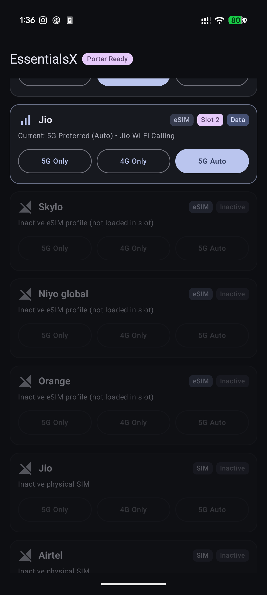
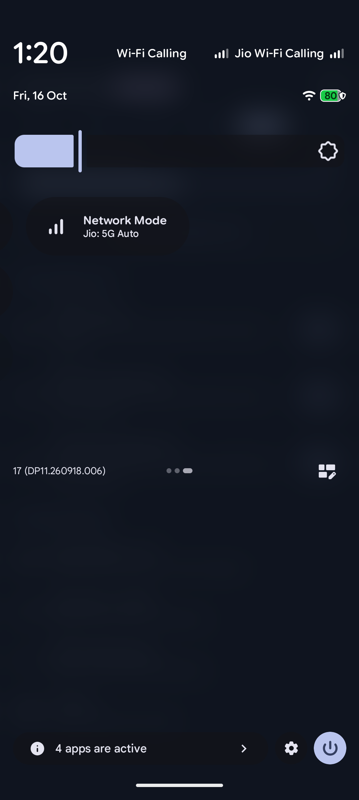
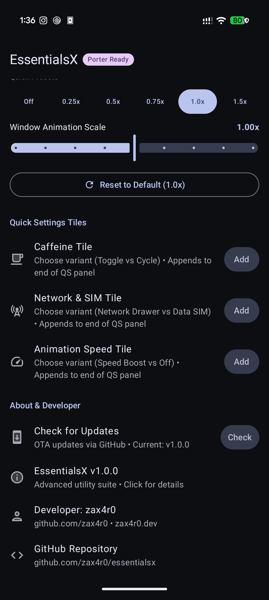
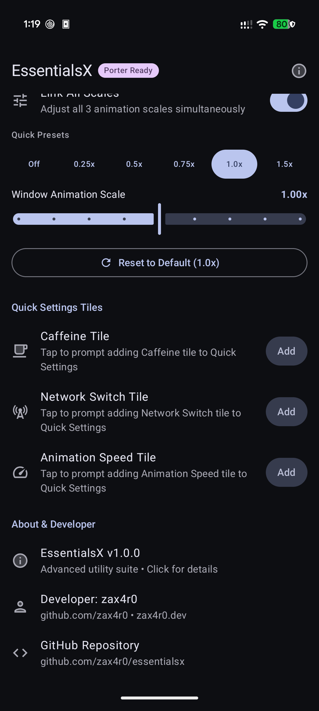

# EssentialsX ⚡

<p align="center">
  <strong>The essential power-user toolkit for Android, built with Jetpack Compose & Material 3.</strong>
</p>

<p align="center">
  <a href="LICENSE"></a>
  <a href="https://developer.android.com/about/versions/oreo"></a>
  <a href="https://developer.android.com/about/versions/16"></a>
  <a href="https://kotlinlang.org"></a>
  <a href="https://developer.android.com/jetpack/compose"></a>
  <a href="https://shizuku.rikka.app"></a>
</p>

---

## 📖 Overview

**EssentialsX** (`eu.zax4r0.essentialsx`) is a lightweight, high-performance system utility tailored for modern Android devices. Designed with a clean, responsive Jetpack Compose Material 3 interface, EssentialsX consolidates vital device controls—keep-awake wake locks, multi-SIM / eSIM cellular mode controls, and custom animation scaling—into a unified, reactive interface.

---

## ✨ Features

### ☕ 1. Caffeine (Keep Screen Awake)
- **Zero elevated privileges needed**: Operates entirely in userland with Android's native WakeLock API.
- **Configurable Timeouts**: Choose from 1m, 5m, 10m, 30m, 1h, or Infinite awake mode.
- **Persistent Notification & Live Countdown**: Easily monitor remaining time or cancel directly from notifications.
- **Quick Settings Tile Variants**: Choose between Infinite Toggle mode or Countdown Preset Cycle mode.

### 📶 2. Multi-SIM & Multi-eSIM Network Switch
- **Per-SIM Control**: Independent network mode switching for each detected SIM card.
- **Full eSIM Discovery**: Accurately queries all installed physical and embedded (eSIM) profiles via `dumpsys isub`.
- **Smart Status Handling**: Active subscriptions provide full switching; inactive or disabled eSIM profiles are gracefully dimmed with disabled controls.
- **Supported Network Modes**:
  - `5G Only` (NR Only - Force SA/NSA 5G connectivity)
  - `4G Only` (LTE Only - Lock device to reliable 4G)
  - `5G Auto` (NR / LTE / WCDMA preferred automatic switching)
- **Quick Settings Interactive Drawer**: Tapping the Network Mode tile collapses the shade and instantly pops open a sleek bottom sheet drawer to configure active SIMs and modes with zero friction.
- **Data SIM Switcher Tile**: Dedicated 1-tap tile to toggle default mobile data between SIM 1 and SIM 2.
- **Privileged Backend**: Executes commands seamlessly via **Shizuku** or **Porter** without needing full device root.

### ⚡ 3. Custom Animation Scales
- **Fluid Window & Transition Speed**: Overwrite system limits with granular precision (from `0.0x` up to `10.0x`).
- **One-Tap Presets**: Instant switches to `Off (0x)`, `0.25x`, `0.5x`, `0.75x`, `1.0x`, and `1.5x`.
- **Link All Scales**: Synchronize Window, Transition, and Animator scales with a single toggle.
- **Privilege Options**: Works with `WRITE_SECURE_SETTINGS` (via ADB) or zero-setup auto-delegation via Porter/Shizuku.
- **Quick Settings Tile**: Toggle between high-speed 0.5x and standard 1.0x animations with one tap.

### 🔄 4. Direct OTA Updates
- **Built-in GitHub Releases updater**: Instantly checks for new versions with changelog and release notes.
- **Direct in-app download and installation**: Downloads latest APKs and triggers system package installer via secure Android FileProvider.

### 🧩 5. Safe Quick Settings Tile Placement
- **Layout Preservation**: Never rearranges or disrupts your existing Quick Settings tiles. Appends new tiles strictly to the very end of `sysui_qs_tiles`.
- **Variant Selection Dialogs**: When adding a tile, select between specialized variants (e.g. Network Drawer vs Data SIM Switcher; Infinite Toggle vs Cycle).

---

## 📱 Screenshots

| Caffeine & Cellular Controls | Per-SIM & Multi-eSIM Details | Animator & Quick Tiles | About & Developer Info |
|:---:|:---:|:---:|:---:|
|  |  |  |  |

---

## 🛠️ Permissions & Setup

EssentialsX is designed with a tiered permission architecture:

| Feature | Required Permission | Setup Method |
|:---|:---|:---|
| **Caffeine** | None (`WAKE_LOCK`, `POST_NOTIFICATIONS`) | Ready out of the box |
| **Animation Scales** | `WRITE_SECURE_SETTINGS` | Shizuku / Porter **OR** ADB command: <br/>`adb shell pm grant eu.zax4r0.essentialsx android.permission.WRITE_SECURE_SETTINGS` |
| **Network Switch & Drawer** | Privileged Shell (`cmd phone`) | Shizuku **OR** Porter daemon |
| **OTA Updates** | `REQUEST_INSTALL_PACKAGES` | Standard Android system prompt |

### Porter Integration
EssentialsX seamlessly links with Porter daemon. If using Porter, add `eu.zax4r0.essentialsx` to your `porter.json` configuration:

```json
{
  "packages": [
    {
      "packageName": "eu.zax4r0.essentialsx",
      "certHash": "04a325910b157c2911d27bc2e9b540569a1a72aecc9c292c68078844d6dc4ee0",
      "permissions": ["all"]
    }
  ]
}
```

---

## 🏗️ Building from Source

### Prerequisites
- JDK 17 or higher
- Android SDK with platform 36 (Android 16)
- Gradle 8.11+ (bundled via `./gradlew`)

### Build Commands
```bash
# Clone the repository
git clone https://github.com/zax4r0/essentialsx.git
cd essentialsx

# Build debug APK
./gradlew assembleDebug

# Build release APK
./gradlew assembleRelease

# Install directly to connected device
./gradlew installDebug
```

---

## 👤 Author

Developed with care by **zax4r0**:
- **GitHub**: [@zax4r0](https://github.com/zax4r0)
- **Website**: [zax4r0.dev](http://zax4r0.dev/)
- **Twitter / X**: [@zax4r0](https://twitter.com/zax4r0)

---

## 📄 License

This project is open-source under the terms of the [MIT License](LICENSE).
