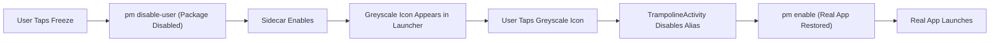

# DroidMode ⚡

<p align="center">
  <strong>The essential power-user toolkit for Android, built with Jetpack Compose & Material 3.</strong>
</p>

<p align="center">
  <a href="LICENSE"></a>
  <a href="https://developer.android.com/about/versions/oreo"></a>
  <a href="https://developer.android.com/about/versions/16"></a>
  <a href="https://kotlinlang.org"></a>
  <a href="https://developer.android.com/jetpack/compose"></a>
  <a href="https://shizuku.rikka.app"></a>
</p>

---

## 📖 Overview

**DroidMode** (`dev.zax4r0.droidmode`) is a lightweight, high-performance system utility tailored for modern Android devices (including Android 15 & Android 16 beta). Designed with a clean, responsive Jetpack Compose Material 3 interface, DroidMode consolidates vital device controls—true package freezing with launcher drawer preservation, keep-awake wake locks, multi-SIM / eSIM cellular mode controls, Wi-Fi priority management, resizable home screen widgets, and custom animation scaling—into a unified, reactive interface.

---

## ✨ Features

### ❄️ 1. True App Freezer (`pm disable-user` with Sidecar Drawer Icons & Usage Tracking)
- **Real Freezing Engine**: Disables target packages using `pm disable-user` / `COMPONENT_ENABLED_STATE_DISABLED_USER` via Shizuku. Unlike package suspension (`pm suspend`) which leaves processes and services able to run in the background on modern Android, True Freezing completely prevents apps from running, starting background services, or consuming battery.
- **Companion Sidecar Architecture**: Android removes launcher icons when apps are disabled. DroidMode solves this by synthesizing an on-device companion app (`dev.zax4r0.droidmode.sidecar`) that provides greyscale `<activity-alias>` entries inside the launcher's app drawer.
- **Flicker-Free Smooth Launch Splash**: Tapping a frozen app immediately displays a clean, themed launch screen with the app's icon, label, and progress indicator. The launcher drawer never flickers or reloads prematurely.
- **Intelligent Foreground Tracking (`PACKAGE_USAGE_STATS`)**: Leverages Android's Usage Stats APIs (auto-granted via Shizuku) to detect when the launched app is actively in use in the foreground.
- **Automatic Re-Freeze on Exit & Screen Lock**: Once you finish using the app (swipe Home, return to drawer, switch apps, or turn off the screen), DroidMode automatically re-freezes the app and restores its greyscale drawer icon.
- **Essentials-Style 4-Column Grid UI**: Adaptive card grid with live frozen counts, greyscale dimming, snowflake freeze badges, single-tap launch, and long-press contextual menus.
- **Full App Settings Backup & Restore**: Export and import all app preferences (Freezer, Caffeine, Smart Network, Wi-Fi Priority, Animator scales, and Update preferences) via standard JSON files using Android Storage Access Framework.
- **One-Tap Home Screen Widget**: Resizable widget that freezes all selected apps with a single tap, and unfreezes the group on the next tap.

### ☕ 2. Caffeine (Keep Screen Awake)
- **Zero elevated privileges needed**: Operates entirely in userland with Android's native WakeLock API.
- **Configurable Timeouts**: Choose from 1m, 5m, 10m, 30m, 1h, or Infinite awake mode.
- **Persistent Notification & Live Countdown**: Easily monitor remaining time or cancel directly from notifications.
- **Quick Settings Tile Variants**: Choose between Infinite Toggle mode or Countdown Preset Cycle mode.

### 📶 3. Multi-SIM & Multi-eSIM Network Switch
- **Per-SIM Control**: Independent network mode switching for each detected SIM card.
- **Full eSIM Discovery**: Accurately queries all installed physical and embedded (eSIM) profiles via `dumpsys isub`.
- **Smart Status Handling**: Active subscriptions provide full switching; inactive or disabled eSIM profiles are gracefully dimmed with disabled controls.
- **Supported Network Modes**:
  - `5G Only` (NR Only - Force SA/NSA 5G connectivity)
  - `4G Only` (LTE Only - Lock device to reliable 4G)
  - `5G Auto` (NR / LTE / WCDMA preferred automatic switching)
- **Quick Settings Interactive Drawer**: Tapping the Network Mode tile collapses the shade and instantly pops open a sleek bottom sheet drawer to configure active SIMs and modes with zero friction.
- **Data SIM Switcher Tile**: Dedicated 1-tap tile to toggle default mobile data between SIM 1 and SIM 2.

### 📶 4. Wi-Fi Priority Manager
- **Automated SSID Prioritization**: Configurable network ranking for automatic switching between preferred Wi-Fi networks.
- **Signal & Band Awareness**: Prefers high-throughput 5GHz networks and optimal RSSI signal bands.
- **Quick Switch Action**: Instant manual trigger to switch to the highest-priority network in range.

### ⚡ 5. Custom Animation Scales
- **Fluid Window & Transition Speed**: Overwrite system limits with granular precision (from `0.0x` up to `10.0x`).
- **One-Tap Presets**: Instant switches to `Off (0x)`, `0.25x`, `0.5x`, `0.75x`, `1.0x`, and `1.5x`.
- **Link All Scales**: Synchronize Window, Transition, and Animator scales with a single toggle.
- **Privilege Options**: Works with `WRITE_SECURE_SETTINGS` (via ADB) or zero-setup auto-delegation via Porter/Shizuku.
- **Quick Settings Tile**: Toggle between high-speed 0.5x and standard 1.0x animations with one tap.

### 📱 6. Fully Resizable 1×1 Home Screen Widgets
- **Adaptive Layout System**: Responsive widget layouts that scale fluidly from expansive cards down to compact 1×1 icon buttons.
- **Dedicated Freezer Widget**: Shows live frozen count, state badges, and toggles frozen state instantly.
- **Caffeine, SmartNet & Wi-Fi Widgets**: Real-time status indicators and quick-toggle controls.

### 🔄 7. Direct In-App OTA Updates
- **Built-in GitHub Releases updater**: Instantly checks for new versions with changelog and release notes.
- **Direct in-app download and installation**: Downloads latest APKs and triggers system package installer via secure Android FileProvider.

---

## 🔬 Architectural Deep-Dive: Overcoming Android OS Restrictions

Modern Android versions (especially Android 14, 15, and 16 beta) enforce stringent sandbox boundaries and permission models. Below is an overview of the core architectural workarounds engineered into DroidMode:

### 1. The Launcher Icon Problem: `pm disable-user` vs `pm suspend`
- **The Challenge**: When an app is suspended (`pm suspend`), standard launchers can keep a greyed icon, but Android 14+ treats suspended apps leniently—background tasks, broadcasts, and push notifications may continue to run. In contrast, `pm disable-user` is a 100% true freeze (the app cannot execute under any circumstance), but Android automatically strips disabled packages from third-party launchers (like Pixel Launcher), making them inaccessible from the app drawer.
- **The Solution**: DroidMode uses true `pm disable-user`, but pairs it with an on-device synthesized companion app called **Sidecar** (`dev.zax4r0.droidmode.sidecar`). The Sidecar declares `<activity-alias>` elements matching every selected app, complete with greyscale icons and names, restoring drawer visibility without compromising real freezing.



### 2. On-Device APK Synthesis & Signing (No Server / No PC Needed)
- **The Challenge**: Android requires every launchable app-drawer entry to be statically declared in an installed APK's manifest. Third-party apps cannot dynamically add entries to another launcher's drawer at runtime.
- **The Solution**: DroidMode embeds `io.github.reandroid:ARSCLib` and Google's `com.android.tools.build:apksig`. When the user selects or updates their freeze list:
  1. DroidMode loads a lightweight base APK template (`sidecar_template.apk`).
  2. Extracts application icons for each selected app and processes them into greyscale bitmaps using `ColorMatrixColorFilter`.
  3. Synthesizes binary XML `<activity-alias>` entries targeting `TrampolineActivity`, pointing metadata to the target package.
  4. Writes and packages the synthesized APK in device cache.
  5. Cryptographically signs the APK on-device using a bundled PKCS#12 keystore (`sidecar.p12`) via `ApkSigner` (supporting both v1 JAR and v2 full-APK signing).

### 3. Bypassing Private Storage Restrictions via Shizuku Stdin Pipe
- **The Challenge**: On Android 11+, application private directories (`/data/user/0/<package>/`) are restricted with `0700` permissions. The `shell` UID (2000) used by Shizuku cannot read or access APK files located in DroidMode's cache. Running `pm install /data/user/0/...` fails immediately with `EACCES (Permission denied)`.
- **The Solution**: Implemented `ShizukuHelper.installApk()` which streams raw APK bytes through Shizuku's standard input (`stdin`) pipe directly into `/data/local/tmp/` (which is fully owned and accessible by the Shell UID). Once streamed, Shizuku executes `pm install -r -d` on the temporary file, and safely wipes it immediately after installation.

### 4. Overcoming `SecurityException: Shell cannot change component state`
- **The Challenge**: In Android 14+, ADB / Shell (UID 2000) is explicitly blocked from changing individual component states inside third-party packages. Running `pm enable dev.zax4r0.droidmode.sidecar/.Alias_xxx` throws:
  ```text
  java.lang.SecurityException: Shell cannot change component state for ComponentInfo{...} to 1
  ```
  This meant shell commands could not be used to dynamically show/hide the drawer icons when an app was frozen or unfrozen.
- **The Solution**: Under Android's security architecture, any package is always permitted to modify its own components via `PackageManager.setComponentEnabledSetting(..., DONT_KILL_APP)`. DroidMode implements a bidirectional IPC bridge:
  - **`SidecarProvider` (`ContentProvider`)**: Handles synchronous `set_state` and `set_all_states` calls from DroidMode to instantly enable/disable aliases in milliseconds.
  - **`SidecarReceiver` (`BroadcastReceiver`)**: Provides broadcast fallback (`dev.zax4r0.droidmode.sidecar.SET_STATE`) with `FLAG_INCLUDE_STOPPED_PACKAGES`.
  - **`TrampolineActivity`**: When tapped by the user, it immediately disables its own alias component on the UI thread before delegating launch to DroidMode.
  - **Result**: Icon visibility toggles dynamically without needing to recompile or reinstall the Sidecar APK. APK regeneration is only required when the static list of selected apps changes.

### 5. Multi-SIM & Cellular Subsystem Privileged IPC
- **The Challenge**: Android's Telephony APIs restrict preferred network mode configuration (`setAllowedNetworkTypesForReason`) and default data SIM switching behind system signature permissions (`MODIFY_PHONE_STATE`).
- **The Solution**: Uses Shizuku IPC to dispatch privileged subcommands (`cmd phone set-allowed-network-types` and `telephony.registry`) directly to `com.android.phone`, enabling granular per-SIM 5G/4G switching across physical SIMs and eSIMs.

---

## 🛠️ Permissions & Setup

DroidMode features a tiered permission architecture:

| Feature | Required Permission | Setup Method |
|:---|:---|:---|
| **Caffeine** | None (`WAKE_LOCK`, `POST_NOTIFICATIONS`) | Ready out of the box |
| **Animation Scales** | `WRITE_SECURE_SETTINGS` | Shizuku / Porter **OR** ADB: <br/>`adb shell pm grant dev.zax4r0.droidmode android.permission.WRITE_SECURE_SETTINGS` |
| **Network Switch & SIM Drawer** | Privileged Telephony Shell (`cmd phone`) | Shizuku **OR** Porter daemon |
| **App Freezer** | Privileged package manager (`pm disable-user`) | Shizuku **OR** Porter daemon |
| **Drawer Greyscale Sidecar** | Silent package installer (`pm install`) | Shizuku streaming install |
| **Foreground App Tracking** | `PACKAGE_USAGE_STATS` | Automatic via Shizuku (`appops`) **OR** Usage Access Settings |
| **OTA Updates** | `REQUEST_INSTALL_PACKAGES` | Standard Android system prompt |

---

## 🏗️ Building from Source

### Prerequisites
- JDK 17 or higher
- Android SDK with platform 36 (Android 16)
- Gradle 8.11+ (bundled via `./gradlew`)

### Build Commands
```bash
# Clone the repository
git clone https://github.com/zax4r0/essentialsx.git
cd essentialsx

# Build Sidecar Template (assets)
./gradlew copySidecarTemplate

# Run Unit Tests
./gradlew testDebugUnitTest

# Build Release APK
./gradlew assembleRelease

# Install directly to connected device
adb install -r -d app/build/outputs/apk/release/app-release.apk
```

---

## 👤 Author

Developed with care by **zax4r0**:
- **GitHub**: [@zax4r0](https://github.com/zax4r0)
- **Website**: [zax4r0.dev](http://zax4r0.dev/)
- **Twitter / X**: [@zax4r0](https://twitter.com/zax4r0)

---

## 📄 License

This project is open-source under the terms of the [MIT License](LICENSE).
